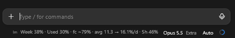

# claude-limit-line

One line under the Claude Code prompt that tells you whether you are burning
through your weekly limit too fast or leaving it unused:



```
lm  Week 38% · Used 30% · fc ~79% · today 2/15% · 5h 51%
```

| Field | Meaning |
| --- | --- |
| `Week` | how much of the current weekly window has passed |
| `Used` | how much of the weekly limit you have used |
| `fc` | forecast: where `Used` lands at the reset if you keep your pace so far. When you would run out first, it says `runs out <day> <time>` instead |
| `today` | spent today / today's allowance: what is left of the limit at midnight, shared out evenly over the days to the reset |
| `5h` | the 5-hour window |

Reading it: `Used` below `Week` means you have room to use more this week;
above it, you are ahead of your budget. `today 2/15%` means 2% spent today of
the 15% you can spend today and still last to the reset.

`today` counts from local midnight, from the last reading the plugin stored
before it: on the day you install it, it counts from its first reading.

## Install

At the prompt of a terminal session (`claude`):

```
/plugin install lm --marketplace brd666/claude-limit-line
```

Answer `y` to add the marketplace, then press Enter for the user scope.

From a shell:

```
claude plugin install lm --marketplace brd666/claude-limit-line
```

In the Claude desktop app, where `/plugin` does not run: click **+** next to the
prompt box, then **Plugins**, **Add marketplace** with
`brd666/claude-limit-line`, then **Add plugin**. A plugin installed from a
terminal at the user scope also loads in the desktop app's Code sessions.

## Commands

| Command | What it does |
| --- | --- |
| `/limit` | the full picture: pace, forecast, how much you can use per day and today |
| `/limit band` | two lines above the prompt instead of the one under it |
| `/limit panel` | a panel beside the chat (with a Close button) |
| `/limit line` | back to the one line under the prompt |

## Where the figures come from

- In the Claude desktop app: the same usage card the app's usage circle shows,
  read every 2 minutes and a few seconds after each answer. It is read only
  where your permissions already allow it, so it never asks you anything.
- Elsewhere: the rate-limit figures that come with Claude's answers. They update
  after each answer and can lag the usage circle by a point.
- It needs a Claude subscription (Pro or Max): with an API key there are no plan
  limits to show.
- The desktop app draws plugin lines beside the model's name, right-aligned, and
  cuts a line that does not fit. In a very narrow window the end may be cut;
  `/limit` always shows everything.

Built and tested with Claude Code 2.1.317 (plugin hook modules).

## По-русски

Строка под полем ввода Claude Code: сколько прошло недели (`Week`), сколько
потрачено недельного лимита (`Used`), прогноз к сбросу при нынешнем темпе
(`fc`), сколько потрачено сегодня / сколько можно потратить сегодня, чтобы
дотянуть до сброса (`today`), и 5-часовое окно (`5h`). Установка — командами
выше. `/limit` показывает подробный расчёт.

## License

MIT
